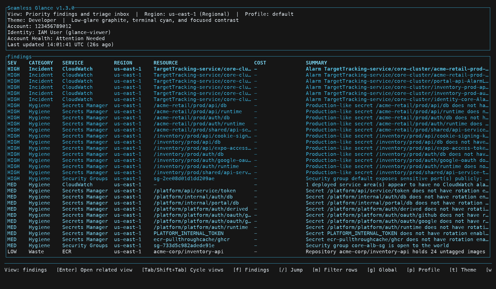
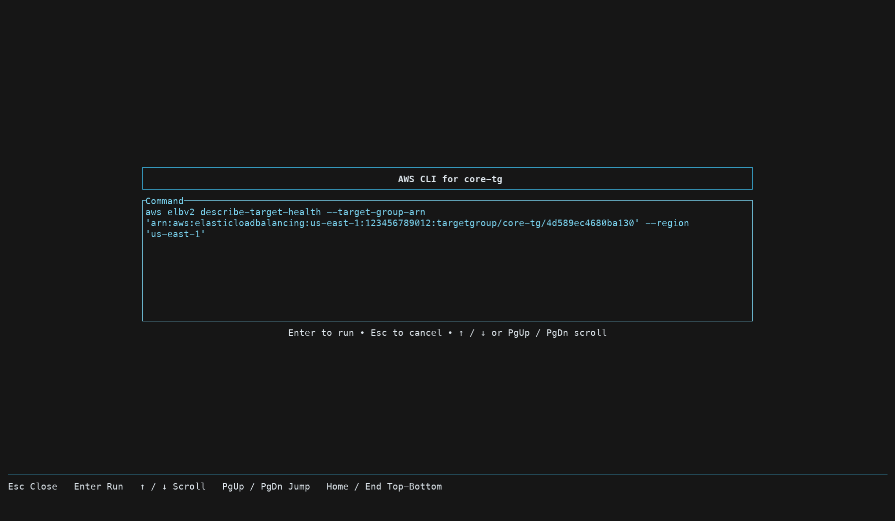
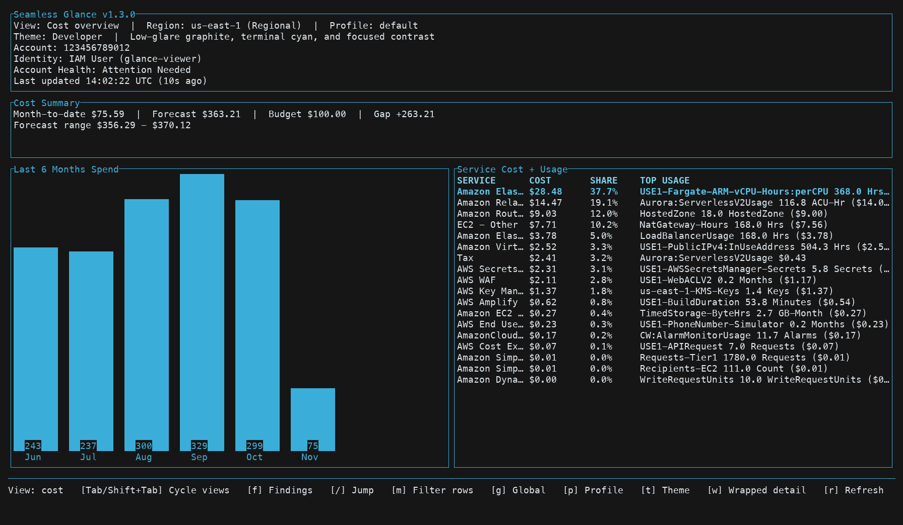
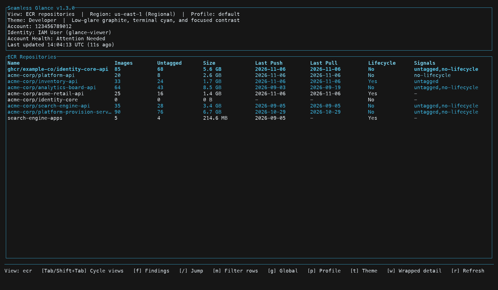
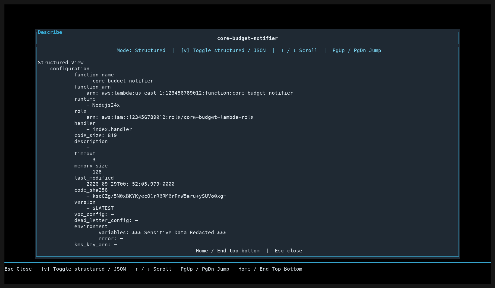
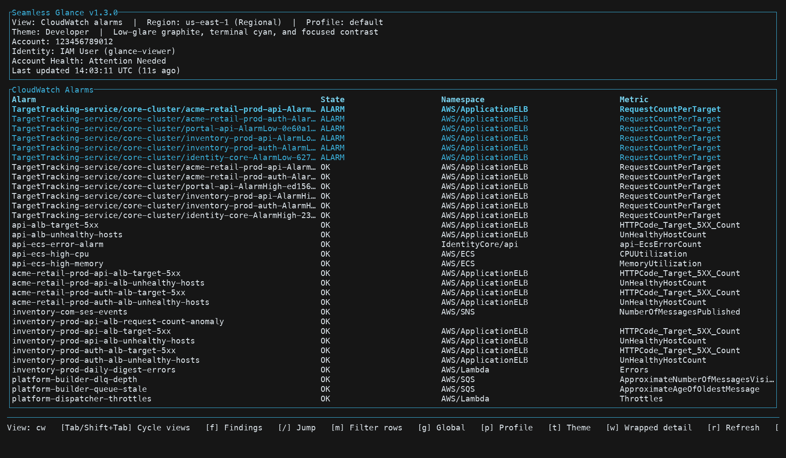
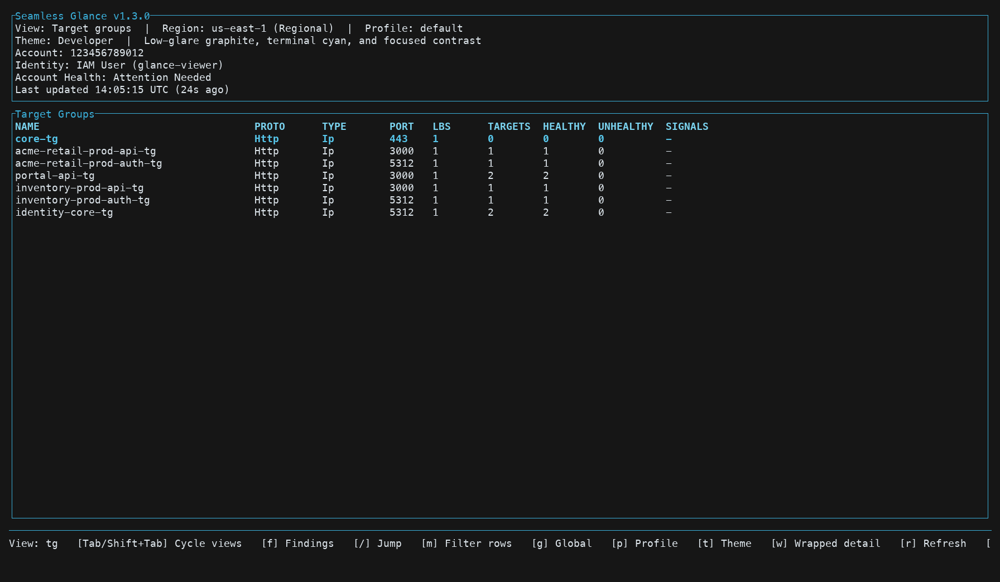
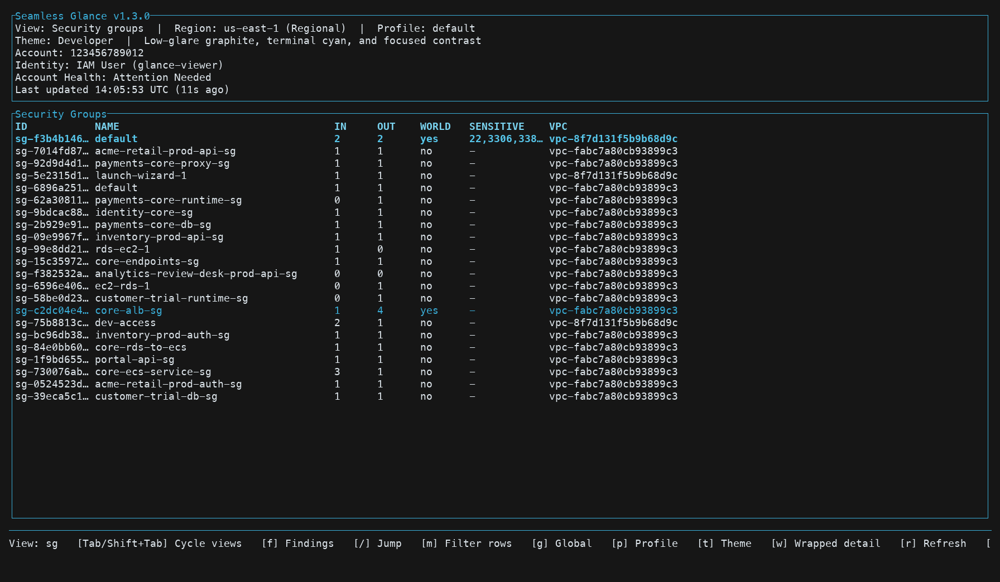
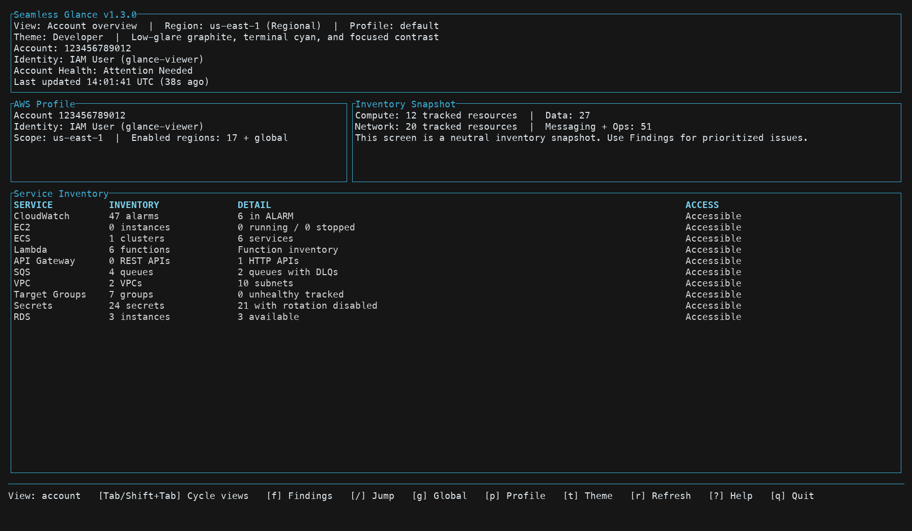

# Seamless Glance

**The AWS terminal UI you hand your team instead of a page of AWS CLI commands.**

[](https://github.com/fells-code/seamless-glance/actions/workflows/ci.yml)
[](https://github.com/fells-code/seamless-glance/releases/latest)
[](https://crates.io/crates/seamless-glance)
[](LICENSE)

Seamless Glance is a fast, read-only TUI for DevOps and cloud engineers. Point it
at an AWS profile and it opens on a ranked list of findings (incidents, waste,
and hygiene), with cost, account inventory, and service health one keystroke
away. When you need to go deeper, it hands you the exact AWS CLI command or
console link for the selected resource.



Website: [seamlessglance.com](https://seamlessglance.com)

## Why

Every team that runs on AWS has the same wiki page: a list of `aws ec2
describe-instances --query ...`, `aws cloudwatch describe-alarms --state-value
ALARM`, and `aws elbv2 describe-target-health ...` snippets that someone pastes
into a terminal when something looks wrong. It works, but only for the person who
already knows which command to run and how to read the JSON.

Seamless Glance replaces that page with one command:

```bash
glance
```

- **Findings first.** Alarms in `ALARM`, target groups with no healthy targets,
  security groups open to the world, idle EC2, stale Lambdas, untagged ECR
  images, and more, ranked by severity with a suggested next step.
- **Cost in context.** Month-to-date spend, forecast, a six-month trend, and a
  savings view that ties spend to the resources behind it.
- **Pivot, do not paste.** `c` shows (and can run) the AWS CLI command for the
  selected resource. `o` opens it in the AWS console. `d` describes it in place.
- **Safe to hand out.** It only makes read calls (`Describe`, `List`, `Get`), uses
  the standard AWS credential chain, and has no telemetry. A teammate can run it
  with a read-only role without being able to change anything.
- **Built for the terminal.** A single Rust binary, keyboard-driven, with region
  and profile switching in-app.

<table>
  <tr>
    <td width="50%"><br /><sub>Press c: the exact AWS CLI command for the selected resource</sub></td>
    <td width="50%"><br /><sub>Cost overview: spend, forecast, and the usage behind it</sub></td>
  </tr>
  <tr>
    <td width="50%"><br /><sub>ECR: untagged images and missing lifecycle policies</sub></td>
    <td width="50%"><br /><sub>Press d: describe any resource in place</sub></td>
  </tr>
  <tr>
    <td width="50%"><br /><sub>CloudWatch alarms by state</sub></td>
    <td width="50%"><br /><sub>Target group health</sub></td>
  </tr>
  <tr>
    <td width="50%"><br /><sub>Security groups open to the world</sub></td>
    <td width="50%"><br /><sub>Account inventory snapshot</sub></td>
  </tr>
</table>

<sub>Captured from v1.3.0 against a real account. Account IDs, resource IDs, and internal names are replaced with placeholders.</sub>

## Install

### Homebrew (macOS, Linux)

```bash
brew install fells-code/seamless/seamless-glance
```

### curl (macOS, Linux)

Detects your platform (Intel/ARM, glibc/musl) and installs the latest release:

```bash
curl -fsSL https://raw.githubusercontent.com/fells-code/seamless-glance/main/install.sh | bash
```

Pin a version with `SEAMLESS_GLANCE_VERSION=1.2.3`. The installer checks the
binary against the release's `SHA256SUMS.txt` and refuses to install it if the
checksum is missing or does not match. The Windows installer below does the same.

### Windows (PowerShell)

```powershell
irm https://raw.githubusercontent.com/fells-code/seamless-glance/main/install.ps1 | iex
```

### Cargo

```bash
cargo install seamless-glance          # build from source
cargo binstall seamless-glance         # fetch the prebuilt release binary
```

Prebuilt binaries are published for macOS (arm64/x86_64), Linux
(x86_64/aarch64, glibc and static musl), and Windows (x86_64). Both
`seamless-glance` and the shorter `glance` alias are installed.

## Quick Start

```bash
glance                       # uses your default AWS profile
glance --profile my-profile  # start on a specific profile
```

Glance resolves credentials exactly like the AWS CLI: environment variables,
`~/.aws/config` and `~/.aws/credentials`, AWS SSO, and assumed roles. If
`aws sts get-caller-identity` works in your shell, Glance will too.

Press `?` at any time for help, `/` to jump to any view, and `q` to quit.

## Security And Permissions

- Read-only. Glance only calls `Describe`, `List`, and `Get` style APIs. It never
  reads secret values (`secretsmanager:GetSecretValue` is not used).
- Local. It runs on your machine, talks directly to AWS API endpoints, and sends
  no telemetry or analytics anywhere.
- Fails closed. If a permission is missing, the affected view shows the access
  error and the rest of the app keeps working.

[`docs/iam-policy.json`](docs/iam-policy.json) is a least-privilege policy that
covers every call Glance makes. Attach it to a dedicated role for teammates who
only need visibility. The `ce:` and `pricing:` actions are only needed for the
cost views.

To report a vulnerability, follow the
[security policy](https://github.com/fells-code/.github/blob/main/SECURITY.md)
rather than opening a public issue.

## Views

| View | What it answers |
| --- | --- |
| Findings | What needs attention right now? |
| Account Overview | What is running in this account and region? |
| Cost Overview | What are we spending, and on what? |
| Cost Savings | Where is money going for little value? |
| EC2, Lambda, ECS, ECR, RDS | Compute and data inventory with health and waste signals |
| API Gateway, SQS, Load Balancers, Target Groups | Traffic paths, queue depth, and target health |
| VPC, Security Groups | Network layout and public exposure |
| CloudWatch | Which alarms are firing, healthy, or missing data |
| Secrets Manager | Which secrets are not rotating |

EC2, Lambda, and RDS also support a `global` region slot that aggregates across
every enabled region. Other views are region-scoped.

### Current Findings

Incident risk:

- CloudWatch alarms in `ALARM`
- target groups with zero healthy or some unhealthy targets
- load balancers with no active target path or zero healthy targets
- SQS queues with high visible or in-flight message counts
- RDS instances that are not available

Waste:

- running EC2 instances averaging below 5 percent CPU over 7 days
- stopped EC2 instances
- Lambda functions with high memory or no deploy in 180+ days
- ECR repositories with 20+ untagged images, or no push in 180 days and no pull in 90
- target groups with no load balancer and no registered targets
- API Gateway APIs with generic names or older than one year

Hygiene:

- security groups open to the world, or exposing sensitive ports publicly
- stopped EC2 instances with public IPs or production-like names
- EC2 instances missing `Name`, `Owner`, or `Environment` tags, and other resources
  missing an `Owner` tag
- production-like single-AZ RDS instances
- secrets without rotation, or with stale rotation
- SQS queues without a DLQ
- default VPCs still present
- deployed services with no matching CloudWatch alarms
- ECR repositories with images but no lifecycle policy

`Enter` on a finding opens the related service view. The
[findings roadmap](docs/findings-roadmap.md) tracks what is coming next, and
[adding a finding](docs/recipes/add-a-finding.md) is a good first contribution.

## Controls

Navigation:

| Key | Action |
| --- | --- |
| `f` | Findings |
| `Tab` / `Shift+Tab` | Cycle through major views |
| `/` | Command palette: jump to any view by name or alias |
| `←` / `→` | Change region |
| `g` | Jump to the `global` region slot |
| `p` | Switch AWS profile |
| `↑` / `↓`, mouse wheel | Move selection or scroll |
| `PgUp` / `PgDn`, `Home` / `End` | Jump through long lists and overlays |
| `?` | Help |
| `q` | Quit |

Resource actions:

| Key | Action |
| --- | --- |
| `Enter` | Open the related view for a finding |
| `d` | Describe the selected resource |
| `v` | Toggle Describe between structured and JSON |
| `c` | Show (and optionally run) the AWS CLI command |
| `o` | Open the selected resource in the AWS console |
| `s` | Prepare an SSH command for the selected EC2 instance |
| `r` | Refresh the active view |
| `w` | Toggle wrapped detail on text-heavy views |
| `t` | Cycle themes |

Actions always target the selected resource's own region, including in the
`global` slot.

Glance captures the mouse so the wheel can scroll. To select text while it is
running, hold a modifier while dragging (Shift in most Linux terminals, Option in
iTerm2, Fn in macOS Terminal).

### Command Palette

Press `/` and type a view name or alias:

- views: `findings`, `account`, `cost`, `savings`, `ec2`, `ecs`, `ecr`, `rds`,
  `lambda`, `apigw`, `sqs`, `vpc`, `cw`, `sm`, `lb`, `tg`, `sg`
- aliases such as `overview`, `billing`, `api`, `queues`, `registry`, `secrets`,
  and `alarms`
- `region <name>` (or `rg <name>`) to change region
- `profile <name>` (or `pf <name>`) to switch profile, or `profile` to open the picker
- `theme <name>` with `autumn`, `winter`, `summer`, `spring`, or `developer`

### Switching AWS Profiles

Press `p` (or run `profile` in the palette) to pick from the profiles in
`~/.aws/config` and `~/.aws/credentials`. Selecting one rebuilds the AWS clients,
keeps the current region, refreshes the active view, and remembers the choice for
the next launch. What a profile can see is governed entirely by its IAM
permissions, not by the app.

## Contributing

Issues and pull requests are welcome. Good places to start:

- [Add a finding](docs/recipes/add-a-finding.md)
- [Add an AWS service view](docs/recipes/add-a-service.md)
- issues labeled
  [`good first issue`](https://github.com/fells-code/seamless-glance/labels/good%20first%20issue)

Build and check locally:

```bash
cargo run
cargo fmt --all
cargo clippy --all-targets -- -D warnings
cargo test --all
```

User-facing changes ship with a [changeset](https://github.com/changesets/changesets):

```bash
npm install          # one-time, installs @changesets/cli
npm run changeset    # pick patch/minor/major and describe the change
```

On merge to `main`, a "version packages" PR is opened automatically. Merging it
builds binaries for every platform, publishes the GitHub Release, updates the
Homebrew tap, and publishes to crates.io. See the [release process](RELEASE.md).

More reading:

- [Architecture](docs/architecture.md)
- [Development guide](docs/development.md)
- [Findings roadmap](docs/findings-roadmap.md)
- [AWS service roadmap](docs/aws-service-roadmap.md)
- [Navigation strategy](docs/navigation-strategy.md)
- [Contributing guidelines](https://github.com/fells-code/.github/blob/main/CONTRIBUTING.md)
  and [code of conduct](https://github.com/fells-code/.github/blob/main/CODE_OF_CONDUCT.md)
- [Agent guidance](AGENTS.md)

## License

Seamless Glance is free and open-source software, licensed under the
[Apache License, Version 2.0](LICENSE). You are free to use, study, share,
modify, and build on it, including in commercial and closed-source work, under
the terms of that license.

Copyright (C) 2026 Fells Code, LLC.
